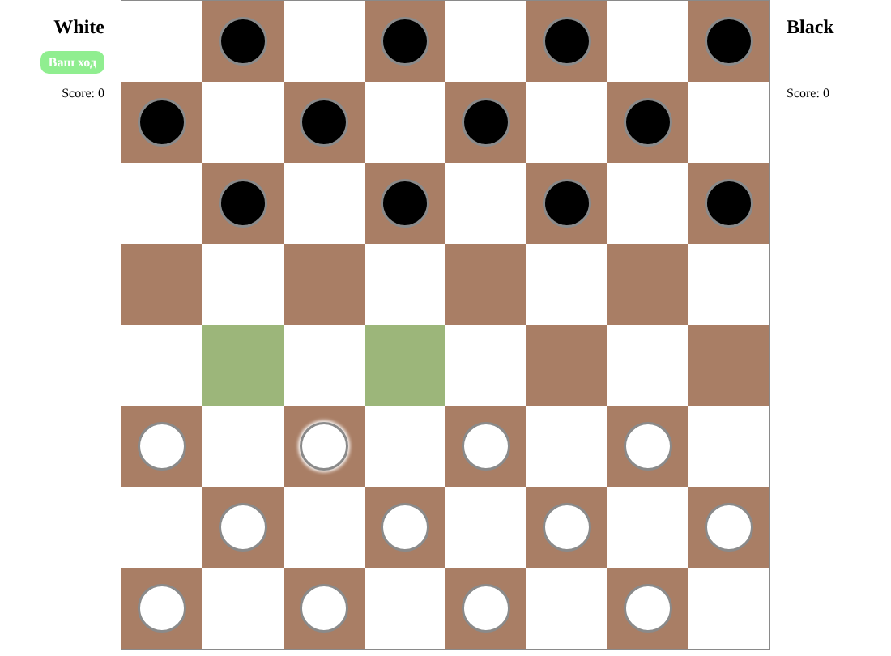

# Шашки

Браузерная игра в русские шашки на двоих игроков за одним экраном. Сделана на Vue 3 как практика по состоянию (Pinia) и композаблам.



## Что реализовано
- Доска 8×8, начальная расстановка, ходы по очереди (белые, чёрные)
- Выбор шашки и подсветка клеток, на которые можно сходить
- Взятие шашки противника, счёт каждого игрока
- Логика ходов вынесена в композаблы (`useFindWays`, `useMoveChecker`, `useTakeEnemy` и др.), состояние хранится в Pinia

## Что пока не сделано
- [ ] Дамки (превращение шашки на последней линии)
- [ ] Обязательное взятие и серия взятий за один ход
- [ ] Определение победителя и кнопка «Новая игра»
- [ ] Игра против компьютера

## Стек
Vue 3 (Composition API) · Pinia · Vite · Less

## Запуск
```bash
npm install
npm run dev      # http://localhost:5173
npm run build    # сборка в dist/
```

## Структура
```
src/
├── components/   CheckersTable, TableCell, UserInfo
├── composables/  правила ходов и взятия
├── store/        доска, текущий игрок, счёт
└── styles/       Less-переменные и общие стили
```

## Автор
Алина Штауб — [портфолио в Figma](https://www.figma.com/)
